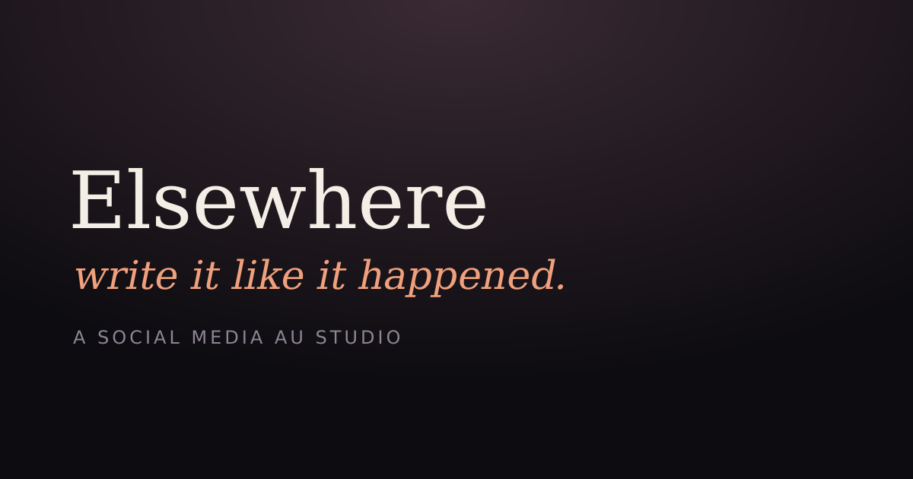

# Elsewhere — a social media AU studio

**Write it like it happened.**



Elsewhere is a private studio for making **social media AUs** — fictional stories told entirely
through the things people post, text and delete. Build fake iMessage threads, Instagram posts and
profiles, X posts and threads, TikTok videos, WhatsApp and Discord chats, Snapchat, Spotify,
YouTube and Reddit screens, then export them as clean, high-resolution screenshots you can post.

It runs in any browser, is designed for a phone first, and **never loses your work** — everything
autosaves to your device as you type, and one tap makes a full backup file.

---

## Open it

- **Live app:** https://anpark101.github.io/for-au/ — served by GitHub Pages from `main`.
  Add it to your phone's home screen (Share → *Add to Home Screen*) and it behaves like an app: it
  opens full screen and works offline once loaded.
- **Run it yourself:**

  ```bash
  npm install
  npm run dev      # http://localhost:5173
  npm run build    # production build in dist/
  ```

### Publishing

Live at https://anpark101.github.io/for-au/ — GitHub Pages, source **GitHub Actions**. Every push to
`main` runs `.github/workflows/deploy-pages.yml`, which builds `dist/` and publishes it.

Setting up a fork? Pick **Settings → Pages → Build and deployment → Source: GitHub Actions**, then
push to `main`. If Pages is off, the workflow still builds green and leaves a notice in the run
summary instead of failing on a missing site.

---

## What's inside

**10 platforms, 17 screen types**

| Platform | Screens |
| --- | --- |
| iMessage | chat (1:1 or group, voice notes, reactions, read receipts), lock screen |
| Instagram | feed post, story (poll + music), profile, direct message |
| X | post, thread, profile |
| TikTok | video, profile |
| WhatsApp | chat with timestamps |
| Discord | server channel chat with reactions |
| Snapchat | chat, snaps, streaks |
| Spotify | now playing with a note |
| YouTube | video with comments |
| Reddit | post with a nested comment tree |

Each screen type is a faithful re-creation of the real interface — status bar, dynamic island,
real brand marks, correct typography, realistic engagement numbers — so a screenshot reads as the
real thing.

**Making a story**

- Library, templates and a demo AU (“After Hours”) so you're never staring at a blank page.
- Shared **cast**: set a name, handle, avatar, bio and follower count once, reuse it on every screen.
- **Look & details**: phone frame, frame colour, status bar time and battery, watermark, theme.
- **Per-screen overrides** for theme, time and battery — so a 4am screen can look like 4am.
- **Reader view**: play the whole story back, one beat at a time, like your readers will.
- **Export studio**: PNG at 1×, 2× or 3×, a ZIP of selected screens, a Markdown story script, and a
  project backup file.

**Saving — the part that matters**

- Autosaves to **IndexedDB** about half a second after you stop typing, with a localStorage fallback.
- A save indicator in the header tells you *Saved*, *Saving…* or if something went wrong.
- Flushes on tab hide / page close, and asks the browser for persistent storage.
- **Settings → Download full backup** writes one `.elsewhere.json` file containing every project,
  screen, caption and photo (images are embedded). **Restore** brings it back on any device.
- Nothing is uploaded. There is no account and no server.

---

## Privacy & the rules of the form

Everything stays on your device. All characters, posts and conversations are inventions — this is a
tool for fiction. Do not use it to impersonate real people or to pass invented screenshots off as
real events.

Not affiliated with Apple, Instagram, X, TikTok, WhatsApp, Discord, Snapchat, Spotify, YouTube or
Reddit.

---

## Tech

React 19 + Vite 8, React Router (hash routing so it works from any static host), hand-written CSS,
`html-to-image` for pixel-exact export, `jszip` for archives, `simple-icons` for brand marks,
`vite-plugin-pwa` for offline/installable support. The 390×844 artboard is the single export unit.

Screen chrome is built to the real apps' grids: SF-metric status bars, Dynamic Island, 17px iMessage
bubbles with tails, Instagram's 32px avatars and 44px action rows, X's inline action row, Roboto for
YouTube. `src/screens/glyphs.jsx` holds the platform glyphs; `src/styles/fidelity.css` is the layer
that pins metrics and type stacks onto the base styles.

```
src/
  components/   shell, nav, modal, toasts, menus
  data/         platforms, templates, demo project, stock scenes, defaults
  editor/       form fields + one form per screen type
  lib/          storage (IndexedDB), store, schema, media, exporter
  pages/        home, templates, workspace, screen editor, reader, export, settings, guide
  screens/      the platform renderers (one file per platform), glyphs.jsx
  styles/       base design system, artboard styles, studio styles, fidelity layer
  dev/          Gallery.jsx — renders every screen type at 1:1 for visual QA
```

### Looking at the screens

`gallery.html` (dev only, not in the production build) renders all 17 screen types at 390×844:
`npm run dev` then open `http://localhost:5173/gallery.html`.
